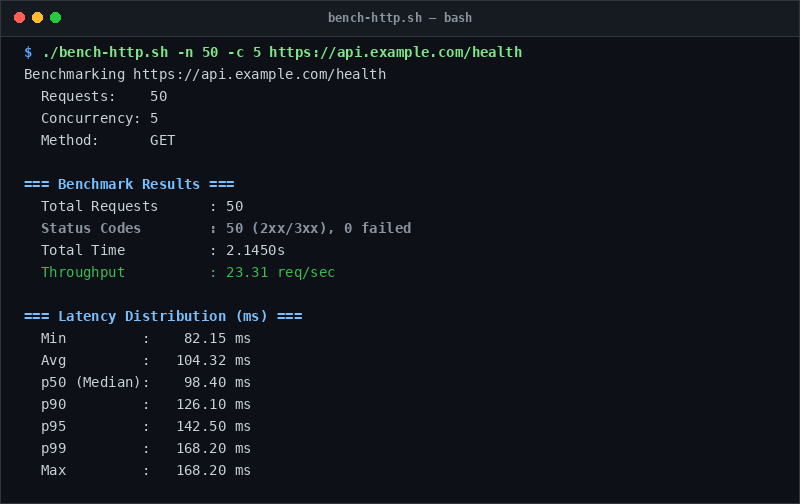

# bench-http

> Lightweight, zero-dependency throughput and latency benchmarker powered by curl.

## Overview
`bench-http.sh` is a single-file, production-grade utility designed for reliable server management and diagnostic workflows.



## Features
- No dependencies required—runs on native bash and curl.
- Configurable request volume (`-n`) and parallel concurrency (`-c`).
- Calculates throughput (requests per second).
- Breaks down latency percentiles: min, average, p50 (median), p90, p95, p99, and max.
- Reports HTTP status code breakdown (2xx/3xx vs failures).

## Usage

```bash
# Run directly from its folder
cd scripts/bench-http
./bench-http.sh -n 50 -c 5 https://api.example.com/health

# Or run from the toolbox root
./scripts/bench-http/bench-http.sh
```

## Options & Arguments

| Option | Description |
| --- | --- |
| `-n, --requests <N>` | Total requests to dispatch (default: `50`) |
| `-c, --concurrency <N>` | Parallel concurrency level (default: `5`) |
| `-X, --method <M>` | HTTP method: GET, POST, HEAD (default: `GET`) |
| `-H, --header <H>` | Custom HTTP request header |
| `-h, --help` | Display usage instructions and exit |

## Conventions
- **POSIX-ish bash**: Runs under standard `/usr/bin/env bash` with `set -euo pipefail`.
- **Zero Heavy Dependencies**: Uses standard Linux utilities.
- **Fail Loudly**: Exits non-zero with actionable errors when diagnostics fail.
