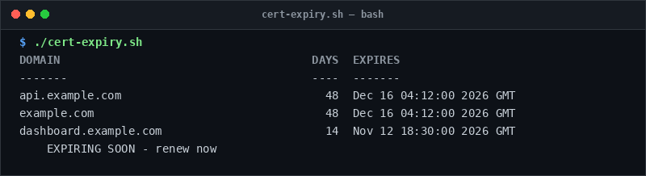

# cert-expiry

> Inspect days remaining on all Let's Encrypt certificates managed by certbot.

## Overview
`cert-expiry.sh` is a single-file, production-grade utility designed for reliable server management and diagnostic workflows.



## Features
- Scans `/etc/letsencrypt/live` for active certificate chains.
- Parses `fullchain.pem` end dates via OpenSSL.
- Flags certificates requiring renewal with tiered warnings (< 30 days, < 7 days).

## Usage

```bash
# Run directly from its folder
cd scripts/cert-expiry
./cert-expiry.sh

# Or run from the toolbox root
./scripts/cert-expiry/cert-expiry.sh
```

## Options & Arguments

| Argument / Env | Description |
| --- | --- |
| `[cert-dir]` | Directory containing cert folders (default: `/etc/letsencrypt/live`) |
| `WARN_DAYS=30` | Warning threshold in days |
| `FAIL_DAYS=7` | Failure/alert threshold in days |
| `-h, --help` | Display usage instructions and exit |

## Conventions
- **POSIX-ish bash**: Runs under standard `/usr/bin/env bash` with `set -euo pipefail`.
- **Zero Heavy Dependencies**: Uses standard Linux utilities.
- **Fail Loudly**: Exits non-zero with actionable errors when diagnostics fail.
