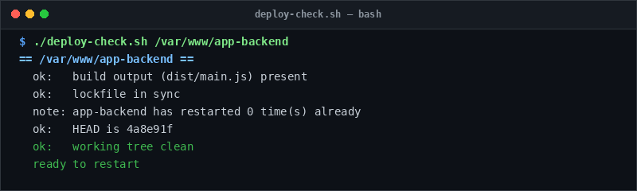

# deploy-check

> Catch build and lockfile issues before restarting production processes.

## Overview
`deploy-check.sh` is a single-file, production-grade utility designed for reliable server management and diagnostic workflows.



## Features
- Verifies production build entrypoints (`dist/`, `build/`, `.next/`).
- Validates lockfile synchronization (`bun.lock`, `package-lock.json`).
- Checks working tree cleanliness and verifies Git commit matching.
- Warns if target process is already crash-looping in PM2.

## Usage

```bash
# Run directly from its folder
cd scripts/deploy-check
./deploy-check.sh /var/www/app-backend

# Or run from the toolbox root
./scripts/deploy-check/deploy-check.sh
```

## Options & Arguments

| Argument | Description |
| --- | --- |
| `<app-dir>` | Directory of the application to check |
| `[expected-commit]` | Short Git SHA expected to be checked out |
| `-h, --help` | Display usage instructions and exit |

## Conventions
- **POSIX-ish bash**: Runs under standard `/usr/bin/env bash` with `set -euo pipefail`.
- **Zero Heavy Dependencies**: Uses standard Linux utilities.
- **Fail Loudly**: Exits non-zero with actionable errors when diagnostics fail.
