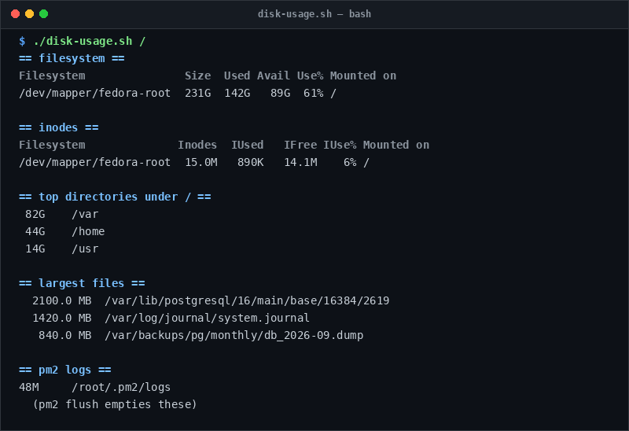

# disk-usage

> Investigate disk consumption, inode limits, and largest files across filesystems.

## Overview
`disk-usage.sh` is a single-file, production-grade utility designed for reliable server management and diagnostic workflows.



## Features
- Displays filesystem utilization and inode allocation.
- Scans top directories under specified mount point.
- Identifies individual files larger than 50MB.
- Checks PM2 log directory sizes and PostgreSQL data cluster footprints.

## Usage

```bash
# Run directly from its folder
cd scripts/disk-usage
./disk-usage.sh /

# Or run from the toolbox root
./scripts/disk-usage/disk-usage.sh
```

## Options & Arguments

| Argument / Env | Description |
| --- | --- |
| `[mount-point]` | Target filesystem mount (default: `/`) |
| `TOP=15` | Number of items to display (default: `15`) |
| `-h, --help` | Display usage instructions and exit |

## Conventions
- **POSIX-ish bash**: Runs under standard `/usr/bin/env bash` with `set -euo pipefail`.
- **Zero Heavy Dependencies**: Uses standard Linux utilities.
- **Fail Loudly**: Exits non-zero with actionable errors when diagnostics fail.
