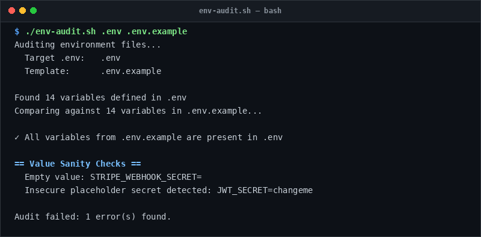

# env-audit

> Validate .env files against .env.example templates before deployments.

## Overview
`env-audit.sh` is a single-file, production-grade utility designed for reliable server management and diagnostic workflows.



## Features
- Cross-references `.env` keys against `.env.example` templates.
- Flags missing required environment variables.
- Surfaces undocumented extra keys.
- Detects unpopulated/empty configuration values.
- Catches Windows CRLF line endings that break shell parsers.
- Scans for insecure placeholder passwords or default tokens.

## Usage

```bash
# Run directly from its folder
cd scripts/env-audit
./env-audit.sh .env .env.example

# Or run from the toolbox root
./scripts/env-audit/env-audit.sh
```

## Options & Arguments

| Argument | Description |
| --- | --- |
| `[env-file]` | Target environment file (default: `.env`) |
| `[example-file]` | Template environment file (default: `.env.example`) |
| `-h, --help` | Display usage instructions and exit |

## Conventions
- **POSIX-ish bash**: Runs under standard `/usr/bin/env bash` with `set -euo pipefail`.
- **Zero Heavy Dependencies**: Uses standard Linux utilities.
- **Fail Loudly**: Exits non-zero with actionable errors when diagnostics fail.
