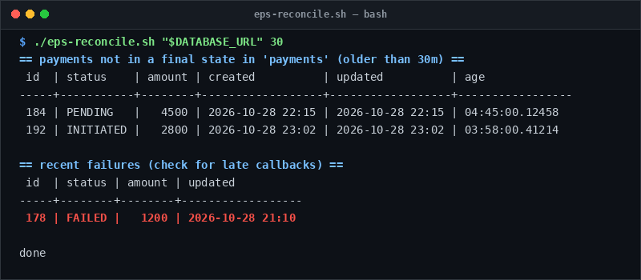

# eps-reconcile

> Detect payments lingering in non-terminal states older than a timeout window.

## Overview
`eps-reconcile.sh` is a single-file, production-grade utility designed for reliable server management and diagnostic workflows.



## Features
- Read-only query script that audits payment tables for stuck states (`INITIATED`, `PENDING`).
- Auto-detects payment table name (`payments`, `payment`, `eps_payment`) or accepts `PAYMENT_TABLE`.
- Surfaces recent failed transactions to verify late gateway callbacks.

## Usage

```bash
# Run directly from its folder
cd scripts/eps-reconcile
./eps-reconcile.sh "$DATABASE_URL" 30

# Or run from the toolbox root
./scripts/eps-reconcile/eps-reconcile.sh
```

## Options & Arguments

| Argument / Env | Description |
| --- | --- |
| `[database-url]` | PostgreSQL connection URL |
| `[older-than-minutes]`| Minimum age in minutes to flag (default: `30`) |
| `PAYMENT_TABLE` | Custom table name override |
| `-h, --help` | Display usage instructions and exit |

## Conventions
- **POSIX-ish bash**: Runs under standard `/usr/bin/env bash` with `set -euo pipefail`.
- **Zero Heavy Dependencies**: Uses standard Linux utilities.
- **Fail Loudly**: Exits non-zero with actionable errors when diagnostics fail.
