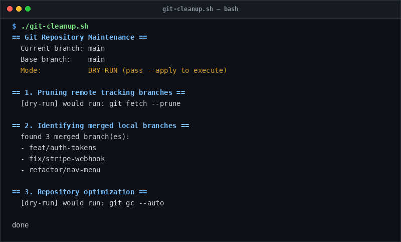

# git-cleanup

> Safely prune merged local branches and optimize git repositories.

## Overview
`git-cleanup.sh` is a single-file, production-grade utility designed for reliable server management and diagnostic workflows.



## Features
- Safe default dry-run mode (`--apply` required to delete branches).
- Prunes dead remote tracking branches with `git fetch -p`.
- Identifies and deletes local branches already merged into `main` or `master`.
- Automatically skips deleting the currently checked out branch.
- Runs `git gc --auto` to repack objects and prune loose references.

## Usage

```bash
# Run directly from its folder
cd scripts/git-cleanup
./git-cleanup.sh

# Or run from the toolbox root
./scripts/git-cleanup/git-cleanup.sh
```

## Options & Arguments

| Option | Description |
| --- | --- |
| `-a, --apply` | Perform actual branch deletion (default is dry-run) |
| `-b, --base <name>` | Base branch to compare against (default: `main` or `master`) |
| `-h, --help` | Display usage instructions and exit |

## Conventions
- **POSIX-ish bash**: Runs under standard `/usr/bin/env bash` with `set -euo pipefail`.
- **Zero Heavy Dependencies**: Uses standard Linux utilities.
- **Fail Loudly**: Exits non-zero with actionable errors when diagnostics fail.
