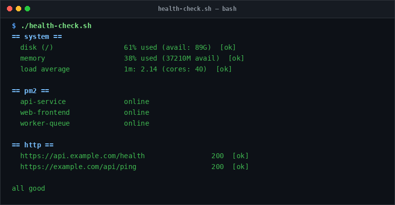

# health-check

> Automated verification of PM2 daemons, HTTP health endpoints, and system resources.

## Overview
`health-check.sh` is a single-file, production-grade utility designed for reliable server management and diagnostic workflows.



## Features
- Auto-detects and monitors all registered PM2 applications.
- Probes HTTP/HTTPS endpoints expecting 200/2xx status responses.
- Enforces system metric thresholds: disk usage %, RAM %, and CPU load averages.
- Accepts custom apps (`-a`) and URLs (`-u`) via CLI or environment variables.

## Usage

```bash
# Run directly from its folder
cd scripts/health-check
./health-check.sh

# Or run from the toolbox root
./scripts/health-check/health-check.sh
```

## Options & Arguments

| Option | Description |
| --- | --- |
| `-a, --apps "app1 app2"` | PM2 application names to check |
| `-u, --urls "url1 url2"` | HTTP/HTTPS endpoints to verify |
| `-s, --system` | Include system threshold checks (default: on) |
| `--no-system` | Skip system resource thresholds |
| `-h, --help` | Display usage instructions and exit |

## Conventions
- **POSIX-ish bash**: Runs under standard `/usr/bin/env bash` with `set -euo pipefail`.
- **Zero Heavy Dependencies**: Uses standard Linux utilities.
- **Fail Loudly**: Exits non-zero with actionable errors when diagnostics fail.
