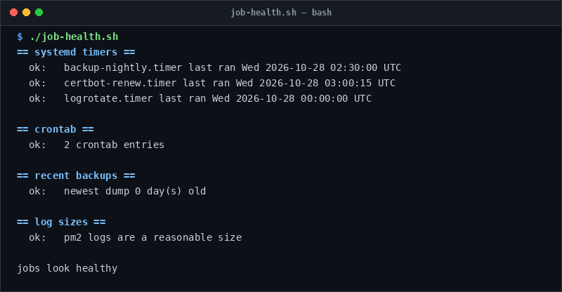

# job-health

> Audit systemd timers, crontab entries, and backup dump freshness.

## Overview
`job-health.sh` is a single-file, production-grade utility designed for reliable server management and diagnostic workflows.



## Features
- Inspects all systemd timers and verifies their `LastTriggerUSec` execution.
- Audits user and system crontabs for active scheduled tasks.
- Verifies database backup dump age (flags if newest backup > 2 days old).
- Checks PM2 logs for runaway sizes (> 200MB).

## Usage

```bash
# Run directly from its folder
cd scripts/job-health
./job-health.sh

# Or run from the toolbox root
./scripts/job-health/job-health.sh
```

## Options & Arguments

| Env Variable | Description |
| --- | --- |
| `BACKUP_DIR` | Path to backup directory (default: `/var/backups/pg`) |
| `-h, --help` | Display usage instructions and exit |

## Conventions
- **POSIX-ish bash**: Runs under standard `/usr/bin/env bash` with `set -euo pipefail`.
- **Zero Heavy Dependencies**: Uses standard Linux utilities.
- **Fail Loudly**: Exits non-zero with actionable errors when diagnostics fail.
