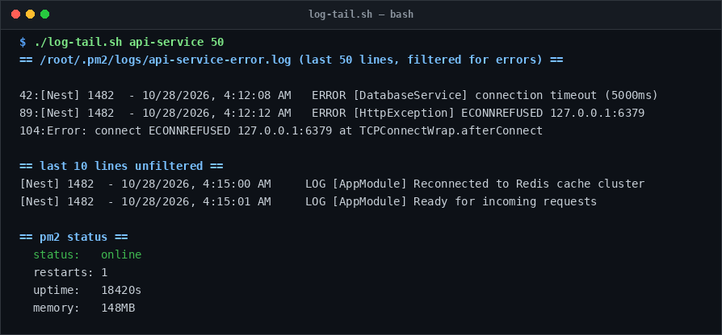

# log-tail

> Filter out verbose framework noise to instantly isolate real application errors.

## Overview
`log-tail.sh` is a single-file, production-grade utility designed for reliable server management and diagnostic workflows.



## Features
- Auto-discovers PM2 error/output log files or inspects direct file paths.
- Filters log streams with targeted regex for panics, unhandled exceptions, and timeouts.
- Shows last 10 raw lines for context.
- Displays PM2 process runtime stats (status, restart count, uptime, memory).

## Usage

```bash
# Run directly from its folder
cd scripts/log-tail
./log-tail.sh api-service 50

# Or run from the toolbox root
./scripts/log-tail/log-tail.sh
```

## Options & Arguments

| Argument | Description |
| --- | --- |
| `<app-or-file>` | PM2 application name or direct file path |
| `[lines]` | Number of filtered error lines to display (default: `200`) |
| `-h, --help` | Display usage instructions and exit |

## Conventions
- **POSIX-ish bash**: Runs under standard `/usr/bin/env bash` with `set -euo pipefail`.
- **Zero Heavy Dependencies**: Uses standard Linux utilities.
- **Fail Loudly**: Exits non-zero with actionable errors when diagnostics fail.
