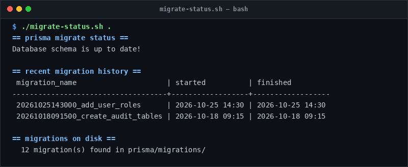

# migrate-status

> Verify Prisma migration sync status without running mutations.

## Overview
`migrate-status.sh` is a single-file, production-grade utility designed for reliable server management and diagnostic workflows.



## Features
- Runs `prisma migrate status` non-destructively.
- Queries `_prisma_migrations` history directly via PostgreSQL.
- Counts on-disk migration directories in `prisma/migrations/`.

## Usage

```bash
# Run directly from its folder
cd scripts/migrate-status
./migrate-status.sh .

# Or run from the toolbox root
./scripts/migrate-status/migrate-status.sh
```

## Options & Arguments

| Argument / Env | Description |
| --- | --- |
| `[app-dir]` | Path to project containing `prisma/schema.prisma` (default: `.`) |
| `DATABASE_URL` | PostgreSQL connection URL |
| `-h, --help` | Display usage instructions and exit |

## Conventions
- **POSIX-ish bash**: Runs under standard `/usr/bin/env bash` with `set -euo pipefail`.
- **Zero Heavy Dependencies**: Uses standard Linux utilities.
- **Fail Loudly**: Exits non-zero with actionable errors when diagnostics fail.
