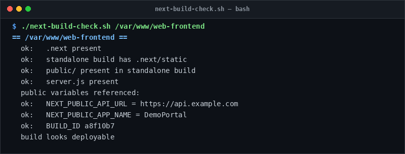

# next-build-check

> Validate Next.js standalone outputs, asset bundling, and env vars before deployment.

## Overview
`next-build-check.sh` is a single-file, production-grade utility designed for reliable server management and diagnostic workflows.



## Features
- Verifies existence of `.next/` directory and `BUILD_ID`.
- Checks standalone directory for required `.next/static` and `public/` assets.
- Scans client bundle for unpopulated or undefined `NEXT_PUBLIC_` environment variables.

## Usage

```bash
# Run directly from its folder
cd scripts/next-build-check
./next-build-check.sh /var/www/web-frontend

# Or run from the toolbox root
./scripts/next-build-check/next-build-check.sh
```

## Options & Arguments

| Argument | Description |
| --- | --- |
| `<app-dir>` | Next.js project root directory |
| `-h, --help` | Display usage instructions and exit |

## Conventions
- **POSIX-ish bash**: Runs under standard `/usr/bin/env bash` with `set -euo pipefail`.
- **Zero Heavy Dependencies**: Uses standard Linux utilities.
- **Fail Loudly**: Exits non-zero with actionable errors when diagnostics fail.
