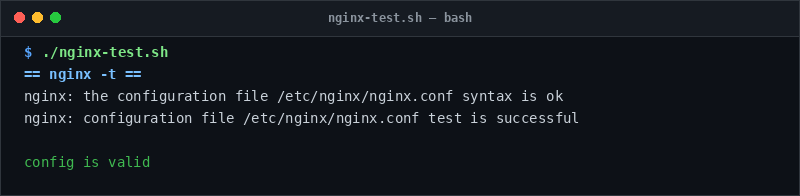

# nginx-test

> Validate Nginx configuration and pinpoint broken virtual host files.

## Overview
`nginx-test.sh` is a single-file, production-grade utility designed for reliable server management and diagnostic workflows.



## Features
- Executes `nginx -t` to validate all loaded virtual hosts.
- Parses error output to pinpoint exact broken `.conf` configuration files.
- Ensures Nginx reload readiness.

## Usage

```bash
# Run directly from its folder
cd scripts/nginx-test
./nginx-test.sh

# Or run from the toolbox root
./scripts/nginx-test/nginx-test.sh
```

## Options & Arguments

| Argument | Description |
| --- | --- |
| `[conf-dir]` | Configuration directory (default: `/etc/nginx/sites-enabled`) |
| `-h, --help` | Display usage instructions and exit |

## Conventions
- **POSIX-ish bash**: Runs under standard `/usr/bin/env bash` with `set -euo pipefail`.
- **Zero Heavy Dependencies**: Uses standard Linux utilities.
- **Fail Loudly**: Exits non-zero with actionable errors when diagnostics fail.
