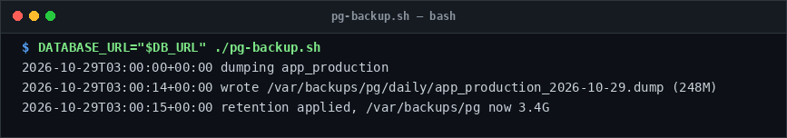

# pg-backup

> Automate compressed pg_dump logical backups with tiered retention tiers.

## Overview
`pg-backup.sh` is a single-file, production-grade utility designed for reliable server management and diagnostic workflows.



## Features
- Produces custom-format compressed PostgreSQL dumps (`--compress=9`).
- Hardlinks daily dumps into weekly and monthly retention tiers.
- Automatically prunes expired backups across daily (14d), weekly (8w), and monthly (12m) windows.
- Supports `--dry-run` to preview backup targets without running `pg_dump`.

## Usage

```bash
# Run directly from its folder
cd scripts/pg-backup
DATABASE_URL="$DB_URL" ./pg-backup.sh

# Or run from the toolbox root
./scripts/pg-backup/pg-backup.sh
```

## Options & Arguments

| Env Variable | Description |
| --- | --- |
| `DATABASE_URL` | PostgreSQL connection URL (required) |
| `BACKUP_DIR` | Backup storage destination (default: `/var/backups/pg`) |
| `KEEP_DAILY=14` | Days to retain daily backups |
| `KEEP_WEEKLY=8` | Weeks to retain weekly backups |
| `KEEP_MONTHLY=12` | Months to retain monthly backups |
| `DRY_RUN=1` | Preview backup operation without executing |
| `-h, --help` | Display usage instructions and exit |

## Conventions
- **POSIX-ish bash**: Runs under standard `/usr/bin/env bash` with `set -euo pipefail`.
- **Zero Heavy Dependencies**: Uses standard Linux utilities.
- **Fail Loudly**: Exits non-zero with actionable errors when diagnostics fail.
