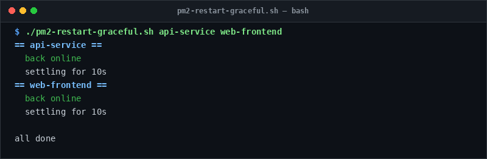

# pm2-restart-graceful

> Restart PM2 applications sequentially with health settlement checks.

## Overview
`pm2-restart-graceful.sh` is a single-file, production-grade utility designed for reliable server management and diagnostic workflows.



## Features
- Restarts applications sequentially rather than all at once.
- Polls `pm2 jlist` until the restarted service is confirmed `online`.
- Displays recent error logs immediately if an app fails to start.
- Configurable settling period between restarts.

## Usage

```bash
# Run directly from its folder
cd scripts/pm2-restart-graceful
./pm2-restart-graceful.sh api-service web-frontend

# Or run from the toolbox root
./scripts/pm2-restart-graceful/pm2-restart-graceful.sh
```

## Options & Arguments

| Option / Env | Description |
| --- | --- |
| `<app> [app...]` | One or more PM2 application names |
| `SETTLE_SECONDS=10`| Sleep duration between successive restarts |
| `DRY_RUN=1` | Test without executing restarts |
| `-h, --help` | Display usage instructions and exit |

## Conventions
- **POSIX-ish bash**: Runs under standard `/usr/bin/env bash` with `set -euo pipefail`.
- **Zero Heavy Dependencies**: Uses standard Linux utilities.
- **Fail Loudly**: Exits non-zero with actionable errors when diagnostics fail.
