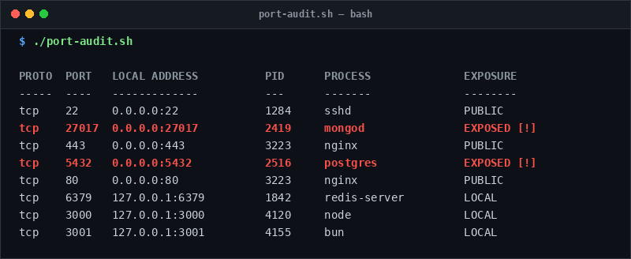

# port-audit

> Inspect listening sockets, process ownership, and detect publicly exposed databases.

## Overview
`port-audit.sh` is a single-file, production-grade utility designed for reliable server management and diagnostic workflows.



## Features
- Enumerates all listening TCP and UDP sockets using `ss`.
- Maps sockets to process executable name and PID.
- Flags dangerous public bindings (`0.0.0.0` or `::`) on internal ports (e.g. Postgres 5432, Mongo 27017, Redis 6379).
- Provides filtered `--warn-only` mode for quick security alerts.

## Usage

```bash
# Run directly from its folder
cd scripts/port-audit
./port-audit.sh

# Or run from the toolbox root
./scripts/port-audit/port-audit.sh
```

## Options & Arguments

| Option | Description |
| --- | --- |
| `-w, --warn-only` | Only display sensitive services bound to public interfaces |
| `-h, --help` | Display usage instructions and exit |

## Conventions
- **POSIX-ish bash**: Runs under standard `/usr/bin/env bash` with `set -euo pipefail`.
- **Zero Heavy Dependencies**: Uses standard Linux utilities.
- **Fail Loudly**: Exits non-zero with actionable errors when diagnostics fail.
