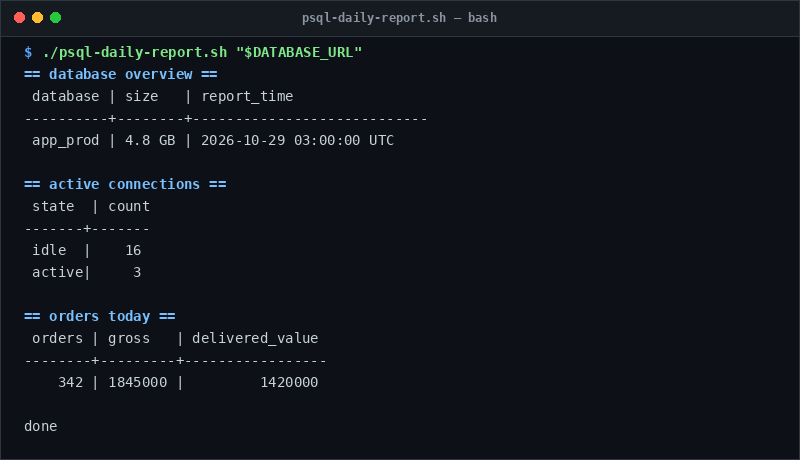

# psql-daily-report

> Generate quick daily database statistics and health reports.

## Overview
`psql-daily-report.sh` is a single-file, production-grade utility designed for reliable server management and diagnostic workflows.



## Features
- Queries database size and current connection activity.
- Checks table existence dynamically before running metric queries.
- Summarizes daily order volumes, user registrations, and payment counts.

## Usage

```bash
# Run directly from its folder
cd scripts/psql-daily-report
./psql-daily-report.sh "$DATABASE_URL"

# Or run from the toolbox root
./scripts/psql-daily-report/psql-daily-report.sh
```

## Options & Arguments

| Argument / Env | Description |
| --- | --- |
| `[database-url]` | PostgreSQL connection URL |
| `DATABASE_URL` | Fallback environment variable |
| `-h, --help` | Display usage instructions and exit |

## Conventions
- **POSIX-ish bash**: Runs under standard `/usr/bin/env bash` with `set -euo pipefail`.
- **Zero Heavy Dependencies**: Uses standard Linux utilities.
- **Fail Loudly**: Exits non-zero with actionable errors when diagnostics fail.
