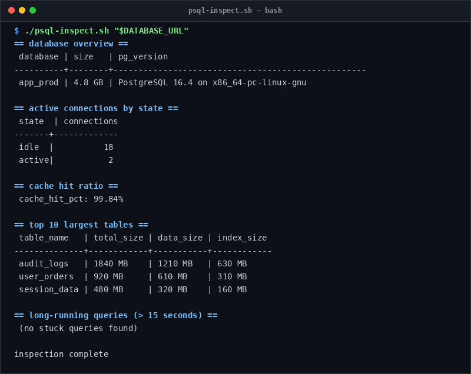

# psql-inspect

> Deep PostgreSQL performance analysis and table diagnostics.

## Overview
`psql-inspect.sh` is a single-file, production-grade utility designed for reliable server management and diagnostic workflows.



## Features
- Displays database disk size and PostgreSQL server version.
- Monitors active connections grouped by state (active, idle, idle in transaction).
- Calculates database buffer cache hit ratio (ideal > 99%).
- Lists top 10 largest tables and indexes with total disk footprints.
- Detects long-running queries (> 15 seconds) and transaction duration.
- Surfaces dead tuple bloat and identifies tables needing VACUUM.
- Detects lock conflicts and blocked transactions.

## Usage

```bash
# Run directly from its folder
cd scripts/psql-inspect
./psql-inspect.sh "$DATABASE_URL"

# Or run from the toolbox root
./scripts/psql-inspect/psql-inspect.sh
```

## Options & Arguments

| Argument / Env | Description |
| --- | --- |
| `[database-url]` | PostgreSQL connection URI |
| `DATABASE_URL` | Environment variable fallback |
| `-h, --help` | Display usage instructions and exit |

## Conventions
- **POSIX-ish bash**: Runs under standard `/usr/bin/env bash` with `set -euo pipefail`.
- **Zero Heavy Dependencies**: Uses standard Linux utilities.
- **Fail Loudly**: Exits non-zero with actionable errors when diagnostics fail.
