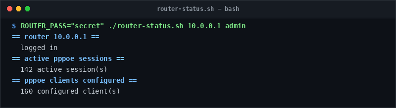

# router-status

> Inspect PPPoE sessions and accounting status on MikroTik routers.

## Overview
`router-status.sh` is a single-file, production-grade utility designed for reliable server management and diagnostic workflows.



## Features
- Connects to MikroTik RouterOS HTTP REST API.
- Authenticates and tracks active PPPoE subscriber sessions.
- Lists session uptime and client connection counts.

## Usage

```bash
# Run directly from its folder
cd scripts/router-status
ROUTER_PASS="secret" ./router-status.sh 10.0.0.1 admin

# Or run from the toolbox root
./scripts/router-status/router-status.sh
```

## Options & Arguments

| Argument / Env | Description |
| --- | --- |
| `<router-host>` | IP or hostname of the router |
| `[username]` | Router username (default: `admin`) |
| `ROUTER_PASS` | Router password environment variable (required) |
| `-h, --help` | Display usage instructions and exit |

## Conventions
- **POSIX-ish bash**: Runs under standard `/usr/bin/env bash` with `set -euo pipefail`.
- **Zero Heavy Dependencies**: Uses standard Linux utilities.
- **Fail Loudly**: Exits non-zero with actionable errors when diagnostics fail.
