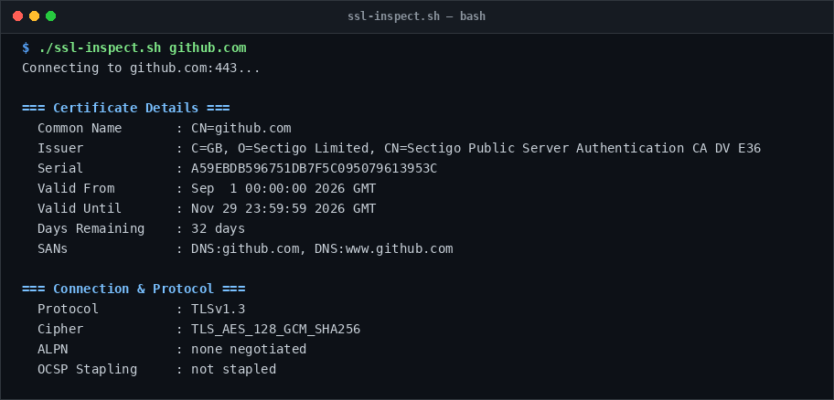

# ssl-inspect

> Inspect remote TLS certificates, cipher suites, and expiry dates without a browser.

## Overview
`ssl-inspect.sh` is a single-file, production-grade utility designed for reliable server management and diagnostic workflows.



## Features
- Fetches and parses X.509 certificate chains directly using `openssl s_client`.
- Displays Subject Common Name (CN), Issuer, Serial, and Subject Alternative Names (SANs).
- Calculates exact days remaining with colorized warnings (< 30 days, < 7 days).
- Displays negotiated TLS protocol version, cipher suite, and ALPN status.

## Usage

```bash
# Run directly from its folder
cd scripts/ssl-inspect
./ssl-inspect.sh github.com

# Or run from the toolbox root
./scripts/ssl-inspect/ssl-inspect.sh
```

## Options & Arguments

| Argument | Description |
| --- | --- |
| `<host>` | Hostname or IP to inspect (supports `host:port`) |
| `[port]` | Target TLS port (default: `443`) |
| `-h, --help` | Display usage instructions and exit |

## Conventions
- **POSIX-ish bash**: Runs under standard `/usr/bin/env bash` with `set -euo pipefail`.
- **Zero Heavy Dependencies**: Uses standard Linux utilities.
- **Fail Loudly**: Exits non-zero with actionable errors when diagnostics fail.
