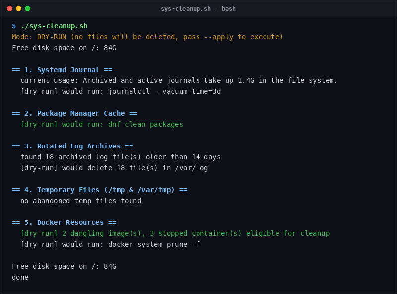

# sys-cleanup

> Reclaim disk space safely with dry-run protection by default.

## Overview
`sys-cleanup.sh` is a single-file, production-grade utility designed for reliable server management and diagnostic workflows.



## Features
- Safe default dry-run mode prevents accidental deletions.
- Vacuums systemd journal logs older than 3 days.
- Cleans package manager caches (`dnf` / `apt-get`).
- Deletes rotated `/var/log` archives (`*.gz`, `*.1`) older than 14 days.
- Prunes abandoned `/tmp` files unaccessed for over 7 days.
- Prunes dangling Docker images, stopped containers, and build cache.

## Usage

```bash
# Run directly from its folder
cd scripts/sys-cleanup
./sys-cleanup.sh

# Or run from the toolbox root
./scripts/sys-cleanup/sys-cleanup.sh
```

## Options & Arguments

| Option | Description |
| --- | --- |
| `-a, --apply` | Execute live deletion (default is dry-run mode) |
| `-h, --help` | Display usage instructions and exit |

## Conventions
- **POSIX-ish bash**: Runs under standard `/usr/bin/env bash` with `set -euo pipefail`.
- **Zero Heavy Dependencies**: Uses standard Linux utilities.
- **Fail Loudly**: Exits non-zero with actionable errors when diagnostics fail.
