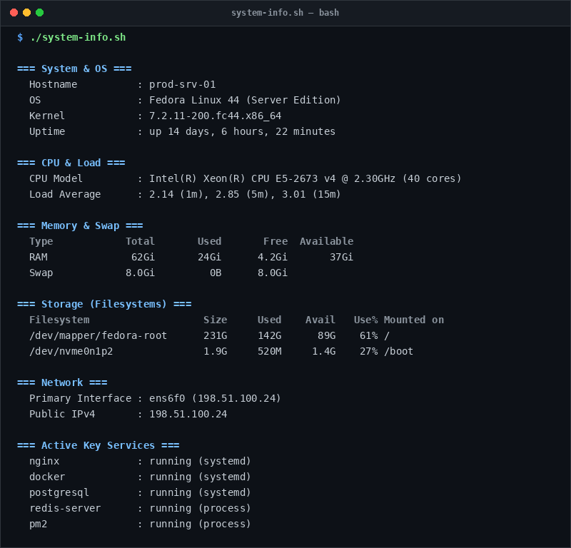

# system-info

> Instant visual terminal snapshot of server metrics and key daemon states.

## Overview
`system-info.sh` is a single-file, production-grade utility designed for reliable server management and diagnostic workflows.



## Features
- Displays OS distro, Linux kernel release, hostname, and system uptime.
- Reports CPU model, architecture, core count, and 1m/5m/15m load averages.
- Displays RAM & Swap utilization breakdown (Total, Used, Free, Available).
- Monitors storage mount points and disk usage percentage.
- Identifies active network interfaces, local IPs, and public IPv4.
- Checks status of key production daemons (systemd, Nginx, Docker, Postgres, Redis, PM2).

## Usage

```bash
# Run directly from its folder
cd scripts/system-info
./system-info.sh

# Or run from the toolbox root
./scripts/system-info/system-info.sh
```

## Options & Arguments

| Option | Description |
| --- | --- |
| `-h, --help` | Display usage instructions and exit |

## Conventions
- **POSIX-ish bash**: Runs under standard `/usr/bin/env bash` with `set -euo pipefail`.
- **Zero Heavy Dependencies**: Uses standard Linux utilities.
- **Fail Loudly**: Exits non-zero with actionable errors when diagnostics fail.
